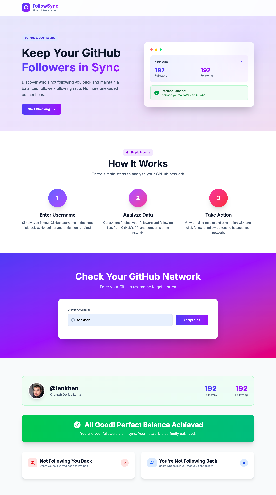

# FollowSync

**GitHub Follow Checker**

FollowSync is a lightweight productivity tool designed to help GitHub users maintain balance between their followers and followings.



---

Many users attempt to increase their follower count by following large numbers of people and then unfollowing after receiving follow-backs. Identifying these patterns manually on GitHub requires switching between followers and following lists and comparing users one by one, which is inefficient and time-consuming.

FollowSync automates this process and presents the results clearly, allowing users to take action instantly.

---

## Purpose

The purpose of FollowSync is to:

- Identify users who are not following you back
- Identify users you are not following back
- Restore balance between followers and followings
- Eliminate the need for manual comparison on GitHub

What previously took close to an hour can now be completed in a few seconds.

---

## How It Works

1. Enter your GitHub username
2. Click the **Analyze** button
3. The application fetches:
   - Your followers
   - Your followings
4. Results are displayed in two columns:
   - Users not following you back
   - Users you are not following back
5. Follow or unfollow users directly from the interface with a single click

---

## Tech Stack

- **Framework:** Next.js
- **Language:** JavaScript
- **API:** GitHub REST API
- **Styling:** Tailwind CSS

The application is fully client-side and does not require a backend or database.

---

## Scripts

```
"dev": "next dev --turbopack",
"build": "next build",
"start": "next start"
```

---

## Setup & Usage

### 1. Clone the Repository

```
git clone <repository-url>
cd followsync
```

### 2. Install Dependencies

```
npm install
```

### 3. Generate a GitHub Personal Access Token (PAT)

You need a GitHub PAT to enable follow and unfollow actions.

- Go to GitHub → Settings → Developer settings → Personal access tokens
- Generate a token with the **user** scope
- This scope allows reading profile data and managing follow relationships

### 4. Add Environment Variable

Create a `.env.local` file in the project root:

```
NEXT_PUBLIC_GITHUB_PAT=your_personal_access_token
```

Restart the development server after adding the environment variable.

---

## Run the App

```
npm run dev
```

Open:

```
http://localhost:3000
```

---

## Optional: Auto‑Load Logged‑In Account

If you want the app to automatically load your own GitHub account without manually typing the username:

### 1. Uncomment the following `useEffect` blocks in `app/page.js`

```js
// useEffect(() => {
//   loadAccountInfo();
// }, []);

// useEffect(() => {
//   handleCompare();
// }, []);
```

### 2. Replace `username` with `account.login` in these API calls

```js
fetchAllPages(\`https://api.github.com/users/\${username}/followers\`)
fetchAllPages(\`https://api.github.com/users/\${username}/following\`)
```

This will automatically analyze the authenticated user’s account.

---

## Pagination Handling

GitHub limits results to 100 users per request. FollowSync automatically fetches all pages to ensure complete and accurate results, even for users with larger networks.

---

## Rate Limits

GitHub API rate limits apply:

- Authenticated requests allow significantly higher limits
- If rate limits are exceeded, the app will show an appropriate error message

---

## Security Notes

- Your GitHub token is used only in your local environment
- The token is never stored in a database or sent to a backend
- Do not commit `.env.local` to version control

---

## License

This project is provided for personal and educational use.  
You are free to modify and extend it for your own needs.

---

## Summary

FollowSync is designed to be fast, practical, and focused on real GitHub usage.  
It eliminates unnecessary manual work and gives users full visibility and control over their follower relationships.
